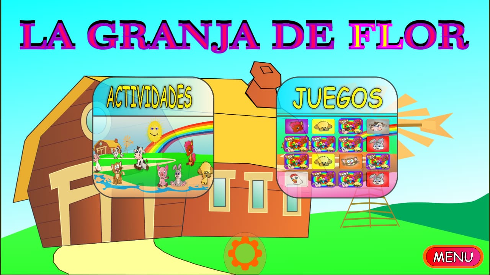
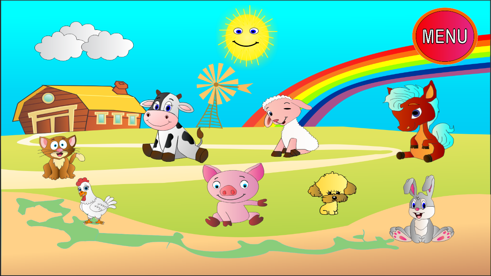
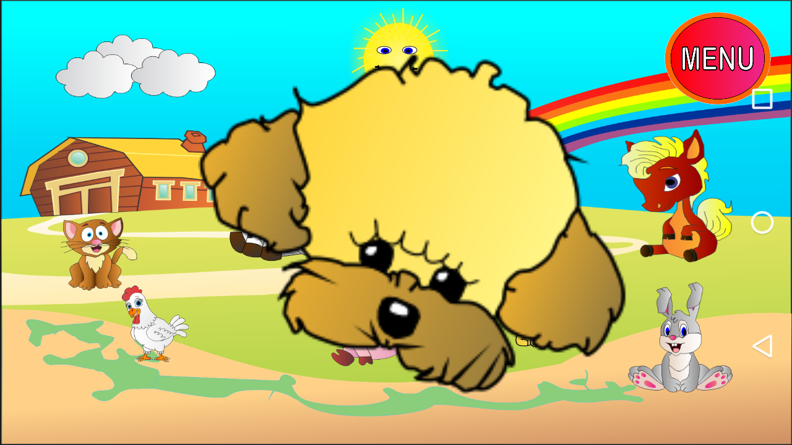
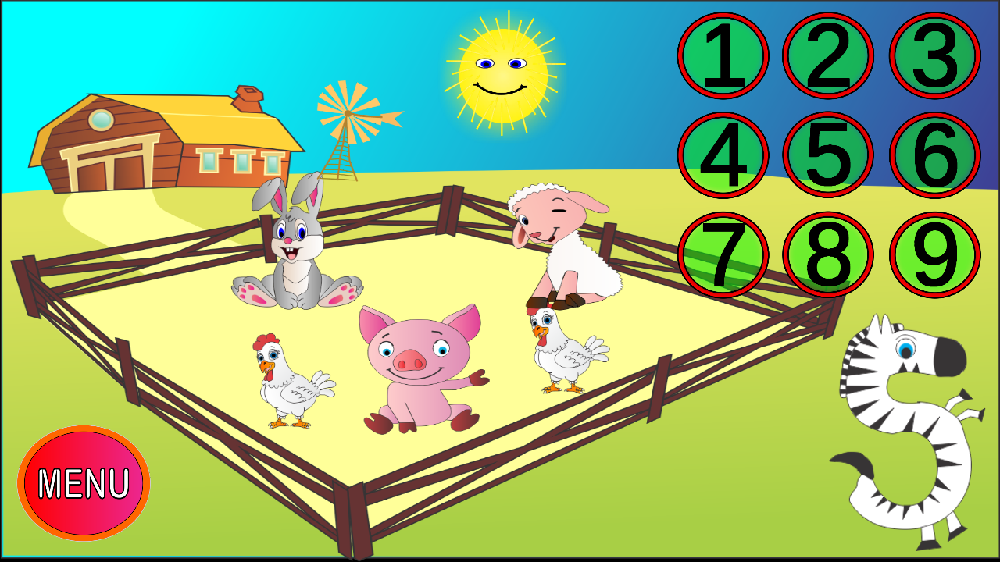
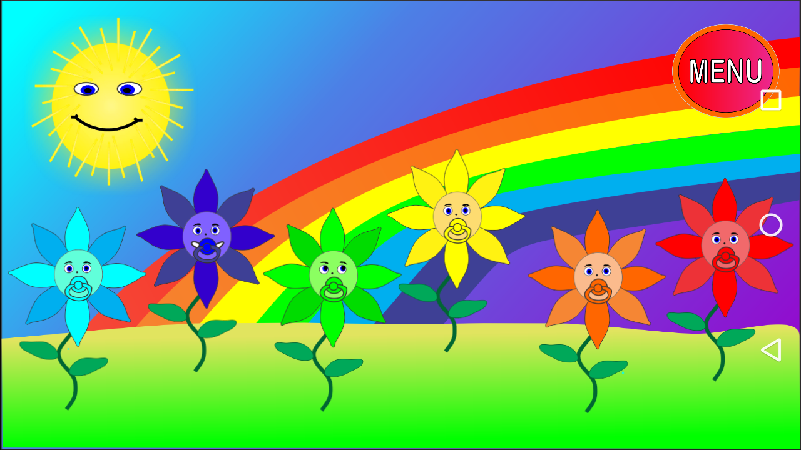
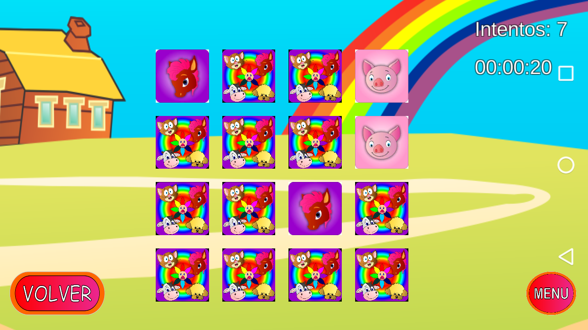
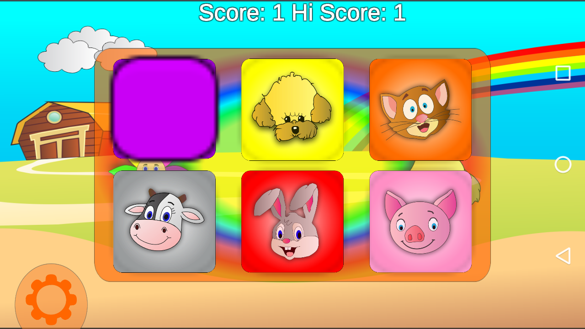

# 📸 La Granja de Flor - Capturas de Pantalla y Recursos Visuales

Este directorio contiene la Galería de imágenes y las capturas de pantalla utilizadas para la documentación del proyecto y el archivo `README.md` principal del repositorio.

---

## 🖼️ Galería de Capturas

### 📱 Navegación Principal e Interfaz de Usuario

| Archivo | Descripción |
| :--- | :--- |
|  | Pantalla del Menú Principal con las secciones de **Actividades** y **Juegos**. |
|  | Actividad de reconocimiento de animales e interacción en la granja. |
|  | Efecto de enfoque / primer plano al interactuar con un animal (Perro). |

### 🎨 Actividades Educativas

| Archivo | Descripción |
| :--- | :--- |
|  | Actividad de conteo y números (del 1 al 9) con representación de animales. |
|  | Actividad de aprendizaje de colores mediante flores interactivas y arcoíris. |

### 🎮 Minijuegos y Modos de Juego

| Archivo | Descripción |
| :--- | :--- |
|  | Minijuego de **Memory (Memotest)** con contador de tiempo, intentos y fichas. |
|  | Minijuego **Flor Dice (Simón Says)** mostrando botones de animales y puntaje (*Score* / *Hi Score*). |

---
